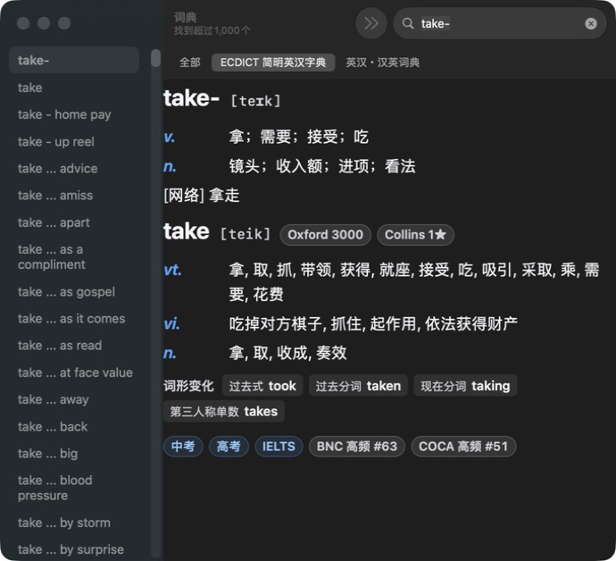
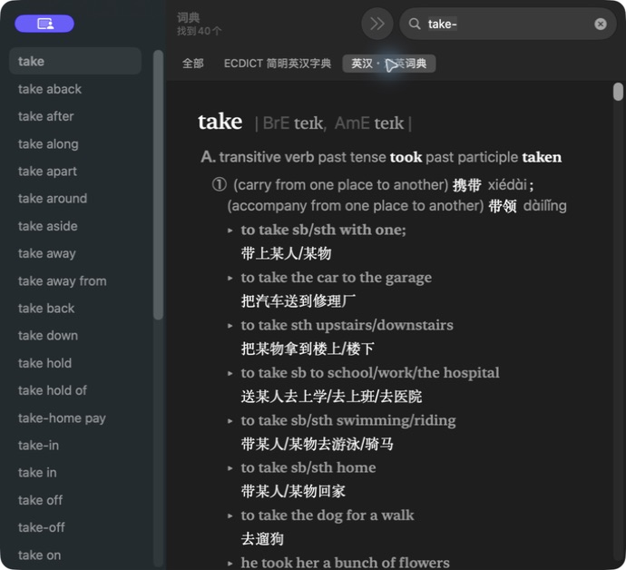

# ECDICT macOS Dictionary

[简体中文](README.md) | **English**

[](https://github.com/343534-code/ecdict-macos-dictionary/releases/latest)
[](#requirements)
[](LICENSE)

**English–Chinese lookup, built into your Mac. Around 3.4 million ECDICT entries, available offline.**

Look up English words while reading, writing, coding, or studying. ECDICT macOS Dictionary brings Chinese definitions to Apple's Dictionary.app and system Look Up, so you can check a word without opening a browser. Once installed, it works offline with no account, ads, or additional background process.

[Download latest release](https://github.com/343534-code/ecdict-macos-dictionary/releases/latest) · [Installation](#installation) · [FAQ](#faq) · [Build from source](#build-from-source)


> **Illustrated interface animation, not a screen recording.** This demonstrates the compact and expanded views in v1.2.1. Panel height, typography, and expansion behavior depend on macOS and the app used for lookup. See the [current layout preview](docs/lookup-preview.md) (Chinese).

> [!IMPORTANT]
> In Dictionary → Settings, enable **ECDICT 简明英汉字典** and **at least one dictionary supplied with macOS**. On some macOS versions, enabling only a third-party dictionary may prevent definitions from appearing.

## Quick start

Open Terminal and run:

```bash
curl -fsSL https://github.com/343534-code/ecdict-macos-dictionary/releases/latest/download/install.sh | /bin/bash
```

The installer downloads the latest release, verifies its SHA-256 checksum, backs up an existing copy with the same name, and installs to `~/Library/Dictionaries/`. No administrator password is required. You can review [`scripts/install.sh`](scripts/install.sh) before running it; its status messages are currently in Chinese.

Then open **Dictionary → Settings** (`Command-,`), enable **ECDICT 简明英汉字典** alongside a built-in dictionary, and search for `two`.

Prefer a manual installation? Download the release ZIP, extract it, and copy the entire `ECDICT 简明英汉字典.dictionary` bundle to `~/Library/Dictionaries/`. Create that folder if needed, then enable the dictionary as above.

## About the dictionary

This project converts the [skywind3000/ECDICT](https://github.com/skywind3000/ECDICT) 1.0.28 MDX data into Apple's native `.dictionary` format, with layouts designed for both Dictionary.app and the compact Look Up panel.

In v1.2.1, Look Up initially shows the first original definition for each part of speech. Expand the panel using the system's “More” control to see remaining definitions and available learning information. Dictionary.app retains the full view, grouped by part of speech.

| Feature | Details |
| --- | --- |
| Data | ECDICT 1.0.28, approximately 3.4 million source entries |
| Lookup | Dictionary.app, right-click Look Up, and three-finger tap in supported apps |
| Entry content | Headword, phonetics, parts of speech, Chinese definitions, and available inflections, exam tags, and BNC/COCA frequency ranks |
| Offline use | Local dictionary data; no account, ads, usage tracking, or additional background process |
| Other formats | Upstream MDX for compatible readers such as Eudic, GoldenDict, and MDict |

The entry count includes inflected forms, phrases, proper nouns, and extended vocabulary; it does not mean 3.4 million distinct everyday words. Available fields vary by entry. This is an **English–Chinese dictionary**, intended for readers who use Chinese definitions.

### Highlights

- **Stay with your reading.** Open complete entries in Dictionary.app or use system Look Up in compatible apps. Gesture support depends on your device and settings.
- **Definitions first, details when needed.** A compact initial view keeps lookup readable; expansion reveals the rest of the entry.
- **Learning information in one place.** Display available pronunciation, Oxford/Collins markers, labeled inflections, exam tags, and corpus frequency ranks from the source data.
- **Use it offline.** After downloading and installing, lookups need no network connection or separate background app.
- **Readable in different contexts.** Includes dark-appearance styling and an MDX option for other readers. macOS controls the final appearance of system Look Up.
- **Inspect the source.** Conversion scripts, styles, build configuration, and data attribution are included.

### Screenshots

The following screenshots show **v1.2.0**, not the latest compact v1.2.1 view. See the [layout preview](docs/lookup-preview.md) (Chinese) for the newer design.

| ECDICT | Dictionary supplied with macOS |
| --- | --- |
|  |  |

Both screenshots were captured in Dictionary.app on the same Mac; neither is a generated interface.

### Understanding the labels

- `Oxford 3000`: membership in the Oxford 3000 core vocabulary, as recorded in the source.
- `Collins 1★–5★`: the source's Collins frequency rating; more stars generally indicate greater frequency.
- `中考`, `高考`, `CET4`, and similar tags: Chinese exam vocabulary labels recorded by ECDICT.
- `BNC #80` / `COCA #60`: ranks in the British National Corpus / Corpus of Contemporary American English; lower numbers indicate more frequent words.

Labels reflect the upstream data, rather than a new assessment or a guarantee of current exam coverage.

### In development: semantic restructuring

A separate, reviewable layer is being developed to organize selected entries by English word sense and add short English explanations and at most one example sentence per entry, without overwriting the original ECDICT data. **The current release uses the original-data rendering; the full dictionary has not been rewritten with AI.** See the [semantic architecture](docs/semantic-architecture.md) (Chinese) for scope and quality gates.

## Requirements

- macOS 10.11 or later is the build target; not every historical version has been tested.
- The installed v1.2.1 dictionary occupies about **424 MiB**. Allow at least **1.5 GB** for downloading, extraction, and backups.
- ZIP and command-line installation are per user and require no administrator password. PKG installation is system-wide and requires one.
- Internet access is needed to download the files, but not to look up words afterward.

## Downloads

Get these files from [Releases](https://github.com/343534-code/ecdict-macos-dictionary/releases/latest):

| File | Purpose |
| --- | --- |
| `ECDICT-macOS-Dictionary-v1.2.1.zip` | Recommended per-user installation; no administrator password |
| `ECDICT-macOS-Dictionary-v1.2.1.pkg` | System-wide graphical installer; unsigned and not notarized |
| `ECDICT-MDX-1.0.28.mdx` | Upstream MDX for compatible dictionary readers |
| `install.sh` | Open-source installer used by the quick-start command |
| `SHA256SUMS.txt` | SHA-256 checksums for release assets |

To check a manual download, obtain `SHA256SUMS.txt` from the **same release** and run this in the download folder:

```bash
shasum -a 256 -c SHA256SUMS.txt
```

If you downloaded only some assets, missing-file warnings for the others are expected. Check that each file you did download reports `OK`.

## Installation

### Option 1: command-line installer

Use the command in [Quick start](#quick-start). After installation, enable ECDICT and a built-in dictionary in Dictionary settings.

If a system-wide copy already exists in `/Library/Dictionaries/`, the installer stops to avoid installing a user-level copy that macOS may ignore. Update that installation using the latest PKG instead.

### Option 2: ZIP with Finder

1. Download and extract the release ZIP.
2. Quit Dictionary completely with `Command-Q`.
3. In Finder, choose **Go → Go to Folder…** and enter `~/Library/`.
4. Open or create the `Dictionaries` folder.
5. Copy the entire `ECDICT 简明英汉字典.dictionary` bundle into it, **not just its `Contents` folder**.
6. Reopen Dictionary and choose **Dictionary → Settings** (Preferences on older macOS versions).
7. Enable **ECDICT 简明英汉字典** and **at least one built-in dictionary**. Drag ECDICT toward the top to prioritize it.
8. Quit and reopen Dictionary, then search for `two`.

If you previously installed experimental ECDICT builds with `优化版`, `高对比版`, or `结构化版` in their names, disable those entries and move their old bundles out of the dictionary folder before using the release build.

### Option 3: PKG installer

1. Download the release PKG and open it.
2. Follow the installer prompts and enter an administrator password when asked.
3. The dictionary is installed to `/Library/Dictionaries/` for users of this Mac.
4. Enable ECDICT and at least one built-in dictionary in Dictionary settings.

> [!WARNING]
> The PKG is unsigned and not notarized. If macOS blocks it, verify that it came from this repository's release and that its checksum matches, then use **System Settings → Privacy & Security → Open Anyway** if you choose to proceed. The ZIP and command-line methods are alternatives.

### Enable three-finger Look Up

In **System Settings → Trackpad → Point & Click**, enable **Look up & data detectors** and select **Tap with Three Fingers**, where available. Try a word in Safari, Notes, TextEdit, or another app supporting system Look Up. Right-click **Look Up** is another entry point.

The available gesture and menu labels vary by macOS version and device. If ECDICT is absent, enable it in Dictionary settings, move it higher in the list, close the lookup panel, and try again.

### Use the MDX in another reader

Download `ECDICT-MDX-1.0.28.mdx`, import it through your reader's dictionary-management interface, and enable it. Eudic, GoldenDict, and MDict use different menu names; follow your reader's import instructions. The macOS-specific layout shown above belongs to the `.dictionary` build.

## Update or uninstall

**To update**, use the same installation method as before: rerun the installer for a user-level copy, or use the latest PKG for a system-wide copy. Quit and reopen Dictionary. Look up `release` and expand “More” to check the additional noun definition, inflections, exam tags, and frequency ranks in v1.2.1.

If Look Up still shows an old layout, save your work and fully quit and reopen the **app initiating the lookup**, such as your browser. Restarting Dictionary alone may not refresh an index held by another app. Sign out and back in if needed. Keep only one release copy across `/Library/Dictionaries/` and `~/Library/Dictionaries/`, as macOS may prioritize the system-wide copy.

**To uninstall**, disable ECDICT in Dictionary settings, quit Dictionary, and move its `.dictionary` bundle to the Trash from the installation folder. A system-wide installation may require an administrator password to remove. Reopen Dictionary afterward.

## FAQ

### The dictionary is missing after installation

Check that the complete `.dictionary` bundle is in the correct folder, quit and reopen Dictionary, and look near the bottom of its settings list. Enable the entry manually. If necessary, sign out of macOS and back in.

### ECDICT appears, but definitions do not

Enable **at least one dictionary supplied with macOS** alongside ECDICT, then fully quit and reopen Dictionary. This addresses a compatibility issue on some macOS versions; it does not mean ECDICT needs internet access. Also check for old experimental copies.

### Why does Look Up look different from Dictionary.app?

macOS can filter or override third-party dictionary CSS in its lookup panel. Colors, dimensions, and expansion behavior may vary by system version, appearance mode, and host app. Dictionary.app displays the full layout.

### Why is the download large?

The dictionary contains about 3.4 million source entries and their offline content. The extracted v1.2.1 bundle occupies about 424 MiB.

## Build from source

You need Python 3, the dependencies pinned in `requirements.txt` (`readmdict==0.1.1` and `python-lzo==1.15`), the LZO library, Apple's Dictionary Development Kit, and the upstream ECDICT MDX.

```bash
brew install lzo
python3 -m pip install -r requirements.txt
python3 scripts/export_ecdict_styled.py \
  "简明英汉字典增强版.mdx" \
  "dictionary-source/ECDICT-styled.xml"
```

Check the Dictionary Development Kit path in `dictionary-source/Makefile`, then build:

```bash
cd dictionary-source
make all
```

Output is written to `dictionary-source/objects/`. A full build takes time and several GB of temporary disk space. The Apple development tools are not included; build compatibility depends on your macOS and kit versions.

## Repository layout

```text
README.md                     Chinese introduction and guide
README.en.md                  English introduction and guide
dictionary-source/            Styles, XSL, preferences, Info.plist, and Makefile
scripts/                      Conversion, installation, and supporting scripts
semantic_cleanup/             Semantic restructuring contracts and validation
docs/                         Layout previews and architecture documentation
tests/                        Automated checks
requirements.txt              Pinned Python build dependencies
LICENSE                       MIT license text retained from ECDICT 1.0.28
NOTICE                        Data attribution and unofficial-project notice
```

## Attribution and license

Dictionary data and the upstream MDX come from [ECDICT 1.0.28](https://github.com/skywind3000/ECDICT/releases/tag/1.0.28). This repository retains its MIT license notice, `Copyright (c) 2017 Linwei`. The MDX's embedded description also refers to “MIT / CC” without identifying a specific Creative Commons variant; this distribution relies on the retained MIT text. Conversion scripts and formatting changes are provided under the same [MIT License](LICENSE). See [NOTICE](NOTICE).

This is an unofficial conversion, with no affiliation with or endorsement by Apple Inc. or the ECDICT maintainers. The content is provided as-is under its license; accuracy and suitability for specialist use are not guaranteed.
